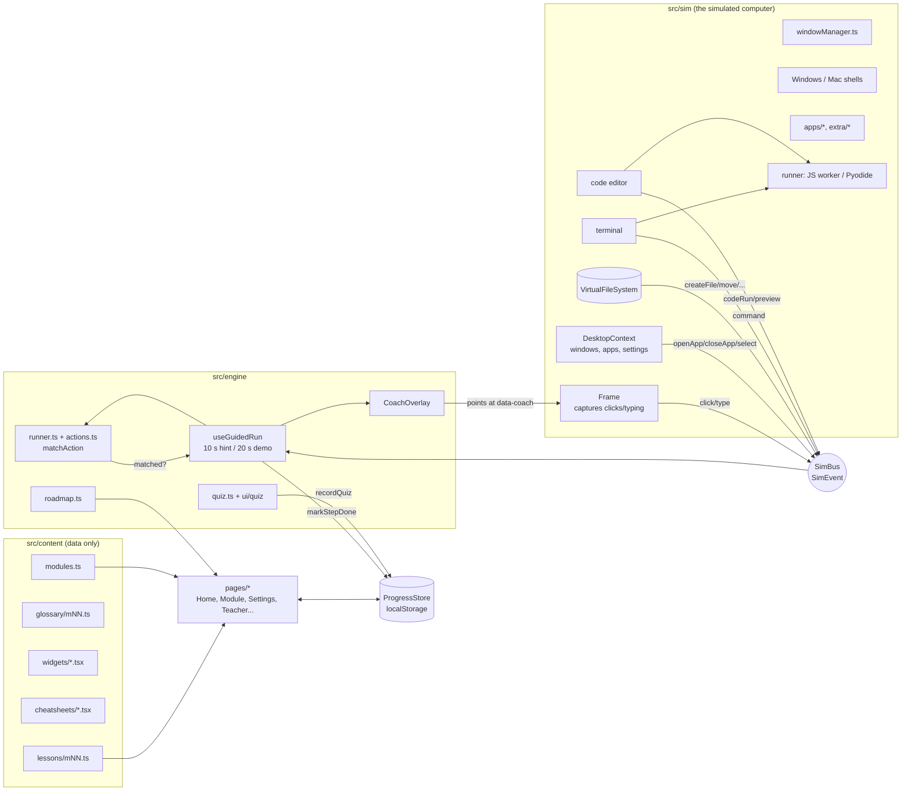

# Architecture

A short tour for whoever maintains the code. For lesson authoring see [README.md](../README.md) and
[LESSON_SCHEMA.md](LESSON_SCHEMA.md); for the simulator's rules see [SIM_CONTRACT.md](SIM_CONTRACT.md).

## The big picture



ASCII version of the same loop:

```
 lesson step ──► useGuidedRun ──► CoachOverlay: "click HERE" (finds [data-coach="..."])
      ▲                │
      │ matched        │ listens
 matchAction ◄──── SimBus ◄── Frame (clicks, typing), VFS (files), DesktopContext (apps),
 (actions.ts)         ▲        terminal (command), editor/runner (codeRun, preview)
      │               │
      └─► next step   └── everything the learner does inside <SimStage>
      │
      └─► ProgressStore.markStepDone(module, os, stepId) ──► localStorage
```

## Engine <-> sim bus <-> coach

- **SimBus** (`src/sim/bus.ts`) is a tiny event emitter. Every learner action in the simulator becomes a typed
  `SimEvent` (`click`, `doubleClick`, `rightClick`, `drag`, `type`, `keyCombo`, `openApp`, `createFolder`, `rename`, `move`,
  `saveFile`, `navigate`, `selectOption`, `custom`, `command`, `codeRun`, `preview`, `predict`). Paths are canonical:
  `~/Documents/x`. The bus keeps the last 200 events, the last code run and the last preview (used by `codeOutputEquals`
  and `previewContains`).
- **Frame** (`src/sim/Frame.tsx`) wraps the simulated screen and captures gestures on any element that has a
  `data-coach` attribute; that is how lessons point at things without the simulator knowing about lessons.
- A lesson **Step** carries an `expectedAction`. **`matchAction`** (`src/engine/actions.ts`) decides whether an event (or,
  for state-based actions like `fileExists`/`fileContains`, the current VFS state) satisfies it. **`runner.ts`** holds the
  pure state machine (`feed`, `advance`, `pickPraise`), and **`useGuidedRun`** (`src/engine/coach/`) drives it from the
  bus with timers: gentle hint after 10 s, "দেখিয়ে দিন" after 20 s, a short praise pause after success.
- **CoachOverlay** draws the ring, the animated cursor, the bubble and the "show me" demo over the simulator. The demo is
  derived from `expectedAction` + `target`, so authors write nothing extra.
- `onStepDone` -> `ProgressStore.markStepDone(module, os, stepId)`. Steps are filtered per OS by `engine/filter.ts`
  (`osVariant`).

## Virtual file system (`src/sim/vfs.ts`)

An in-memory tree per simulated computer, seeded as `C:\Users\Anika\...` (Windows) or `/Users/anika/...` (Mac). It does
folders/files, rename/move/copy, a bin/trash with restore, search, mounted drives (USB, phone) and `serialize()`. All
mutations emit bus events, so file steps work without any extra wiring. A lesson's `setup.vfs(vfs, os)` callback seeds
extra files. A fresh VFS is created each time a simulation starts (practice never persists, by design).

## Window manager (`src/sim/windowManager.ts`)

Pure functions over a list of window states (open, close, focus/z-order, minimise, maximise, drag, resize, MRU order for
Alt+Tab/Cmd+Tab), unit tested without React. `DesktopContext` owns the state (windows, settings such as wallpaper/Wi-Fi/
volume/theme, installed apps, open overlays) and exposes `useDesktop()`. The two shells (`windows/WindowsShell.tsx`,
`mac/MacShell.tsx`) render taskbar/Start/tray or menu bar/Dock/Launchpad/Spotlight around a shared `WindowLayer`.
Pointer-based drag and drop lives in `dnd.tsx` and is also used by quiz drag-match.

## Apps, extras and auto-registration

Registries are filled by `import.meta.glob`, so adding a file is enough:

| What | Where | Mechanism |
|---|---|---|
| Lessons | `content/lessons/mNN.ts` | lazy `import.meta.glob`; `loadLesson(n)` |
| Glossary | `content/glossary/mNN.ts` | eager glob, sorted by Bengali collation |
| Widgets | `content/widgets/<id>.tsx` | lazy components keyed by file name |
| Cheat sheets | `content/cheatsheets/<id>.tsx` | eager glob |
| Simulated apps | `sim/apps/extra/*.tsx` exporting `register()` | `registerBuiltinApps()` in `sim/apps/index.tsx` |
| Browser sites | `sim/apps/browser/sites/*.tsx` calling `registerSite()` | imported by `BrowserEntry.tsx` |
| System shortcuts | `registerSystemShortcut()` in an extra module | `sim/systemActions.ts` |

Heavy apps (Browser, Settings, Code Editor) are code-split with `lazyApp`. The app registry (`sim/apps/registry.ts`)
maps an id like `files`, `editor`, `terminal`, `code` to a title (per OS), icon and component.

## Runner, terminal and editor

- **Runner** (`src/sim/runner`, see [RUNNER.md](RUNNER.md)): `runCode({language, code, inputs})` never throws. JavaScript runs
  in a Blob Web Worker with network globals removed; Python runs in a self-hosted Pyodide worker (lazy, ~13 MB). `input()`
  uses a replay strategy (no SharedArrayBuffer, so any static host works). Errors are translated into friendly Bengali
  (`errors.ts`) but the original English message is always shown too.
- **Terminal** (`src/sim/terminal`): a command engine (`engine.ts`, pure and unit tested) with a PowerShell-style and a
  zsh-style flavor on top of the shared VFS: navigation, files, `>`/`>>`, history, Tab completion, `python`/`node` running
  files through the runner, and blocked dangerous commands with a Bengali explanation. It emits a `command` event.
- **Code editor** (`src/sim/editor`): CodeMirror 6 with an explorer, tabs, run button, input prompt box and a sandboxed
  preview iframe (`sandbox="allow-scripts"`, CSP, no network). Emits `saveFile`, `codeRun`, `preview` and `custom`
  events (`code-saved`, `code-run-ok` ...).

## Content / data model

`src/engine/types.ts` is the contract: `Lesson` (explanation blocks, `steps` or `chapters`, free practice, quiz, summary,
real-world tasks, teacher tip, glossary ids, `setup`), `Step`, `ExpectedAction`, `QuizQuestion` (5 types), `Chapter`,
`ModuleMeta`, `GlossaryEntry`. `content/modules.ts` is the curriculum list; `engine/roadmap.ts` derives
completed/unlocked/locked/soon states and "আজকের পাঠ". `src/content/content.test.ts` enforces lesson integrity.

## State and progress (`src/state`)

`ProgressStore` (`progress.ts`) is plain TypeScript with no React: a single `ProgressData` object (profile, settings,
per-module progress, notebook, certificates, `extras`) persisted as JSON under `computer-shikhi:v1`.

- Storage access is wrapped in try/catch; if `localStorage` is blocked it falls back to an in-memory store and the UI says
  so (`store.persistent === false`).
- `sanitize()` validates and normalises anything loaded or imported; a file that is not ours (or a newer schema version)
  throws and import returns `false` without touching current data.
- Steps are stored **per OS flavor** (`stepsDone.windows` / `stepsDone.mac`) by step id.
- `useProgress()` (`store.ts`) is a `useSyncExternalStore` hook over the singleton store.
- `applySettings` mirrors theme and text size onto `<html data-theme data-text>`; CSS reacts to those.
- Export/import: `store.exportJson()` / `store.importJson(text)`; downloads go through `src/lib/download.ts`.

### Teacher dashboard

`src/lib/teacher.ts` holds the pure logic: `lessonMetaOf(lesson)` (step counts and ids per OS, quiz question texts),
`summarize(progressData, metas, now)` -> `TeacherSummary` (overall/part progress, per-module status, steps done/total per
OS, quiz best/last/retries, weak questions from `quiz.wrongByQuestion`, weak modules: best quiz below 60% or guided steps
stalled for 7+ days, recent activity), and `buildReportHtml()` for the downloadable report. `src/pages/Teacher.tsx` loads
every lesson lazily (`loadLesson`), reduces each to metadata, and renders the tables.

## Build, PWA and hosting

- Vite builds a static site; `base: './'` + `HashRouter` mean it runs from any path with no server rules.
- `vite-plugin-static-copy` copies Pyodide's six files from `node_modules/pyodide` to `<base>/pyodide/` (skipped under Vitest).
- `vite-plugin-pwa` generates the service worker at build time (never in dev): the app shell and every lazy chunk are
  precached; Pyodide is cached in the background/at runtime. `src/pwa/` registers it and downloads the offline cache.
  See [OFFLINE.md](OFFLINE.md).
- `index.html` carries a strict Content-Security-Policy (same origin only); `npm run check:privacy` /
  `tests/privacy.test.ts` guard against network APIs and third-party URLs. See [PRIVACY.md](PRIVACY.md).
- Tests: Vitest + Testing Library next to the code; Playwright specs in `e2e/` against the production build.
